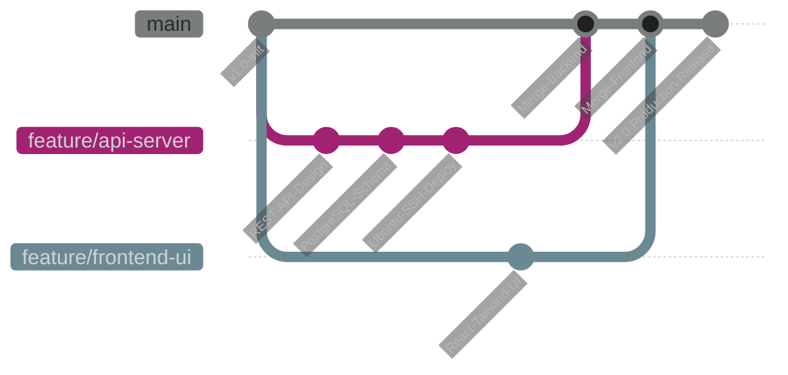

<!-- Header banner -->

  

  

  
  
  
  

  
  
  

---

## 👨‍💻 About Me

I'm a **Full Stack Developer and Software Engineer** with hands-on experience building responsive web applications, mobile applications, database-driven systems, and real-world client projects. As an active **freelancer**, I take projects from requirements and UI/UX design through backend integration, database implementation, testing, and deployment.

I design **RESTful APIs** and manage **Ubuntu backend servers over SSH**, and I run the programming YouTube channel **[code for programming](https://www.youtube.com/@Jeslin_14)**.

| | |
|---|---|
| 🔭 **Currently** | Freelance full-stack projects, custom API development, scalable architectures |
| 🎓 **Education** | B.Tech, Computer Science & Engineering, Karunya Institute of Technology and Sciences (2025 – 2029) |
| 🎥 **Creator** | [code for programming](https://www.youtube.com/@Jeslin_14) on YouTube |
| 💬 **Ask me about** | End-to-end app development, backend server setup, API integration |
| 📍 **Based in** | Chennai, Tamil Nadu, India |

---

## 🛠️ Tech Stack

  

| Category | Technologies |
|---|---|
| **Languages** | Java, Python, C, C++, TypeScript |
| **Frontend** | React, Tailwind CSS, HTML, CSS, JavaScript |
| **Backend & APIs** | Python, Java, RESTful API design |
| **Databases** | PostgreSQL, MongoDB, SQLite |
| **DevOps & Tools** | Ubuntu Server, SSH deployment, Git, GitHub |

---

## 📊 GitHub Stats

  
  

### 🔥 Contribution Streak

  

### 📈 Contribution Activity

  

### 🏆 Trophies

  

---

## 💼 Experience

| Role | Organization | Period |
|---|---|---|
| **Freelance Full Stack Engineer** | Self-employed | Ongoing |
| **Java Full Stack Developer Intern** | CCS Info Tech | May 2026 |
| **Mobile Application Developer Intern** | CodSoft | Feb 2026 – Mar 2026 |

- **Freelance:** Delivering custom web and mobile solutions, building API architectures, managing database implementations, and deploying applications for clients.
- **CCS Info Tech:** Java full stack development, frontend/backend integration, debugging and testing in a professional environment.
- **CodSoft:** Built mobile application components, implemented core functionality, and improved UI performance.

---

## 🚀 Featured Projects

| Project | Description | Stack |
|---|---|---|
| **ARK Kitchen** | Real-world client web application with a Python backend and responsive UI/UX. Deployed to production on Ubuntu via SSH. | Python, UI/UX, Ubuntu, SSH |
| **ER Hospital Scheduling System** | Database-driven scheduling with role-specific workflows for Doctors, Nurses, and Patients. | PostgreSQL |
| **Rural Offline Learning Platform** | Smart India Hackathon proposal: offline-first learning for students with unreliable connectivity. | Offline-first design |
| **Solar Cooker** | Solar cooker prototype with Arduino and programmed control logic. | Arduino, C++ |
| **Galaxy Portfolio** | Animated portfolio with file upload and SQLite-backed storage. | HTML, CSS, JS, Node.js, SQLite |

---

## 📜 Certifications

- Red Hat Linux Certification
- Google Cloud Digital Leader
- Cisco: Introduction to Cybersecurity
- Cisco: HTML, CSS, JavaScript and Python

---

## 🔀 Development Workflow

---

## 🤝 Let's Connect

  I'm open to freelance projects and collaborations. Reach out and let's build something scalable together.

  
  

  

