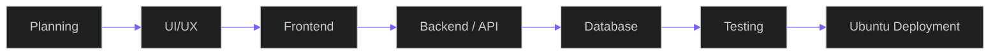

<!-- ============================ HEADER ============================ -->

  

  

  
  
  

  
  

---

## About Me

I'm a **Full Stack Developer and freelancer** who builds and ships software across the whole development lifecycle:

  <b>Requirements → UI/UX Design → Frontend → Backend APIs → Database → Testing → Deployment</b>

My work covers responsive web applications, mobile applications, and database-driven systems. I design RESTful APIs and deploy applications to Ubuntu servers over SSH, taking projects from the first requirements discussion to a live production environment.

| | |
|:--|:--|
| **Current focus** | Freelance full-stack projects, API integration, and production deployment |
| **Education** | B.Tech in Computer Science and Engineering, Karunya Institute of Technology and Sciences (2025 – 2029) |
| **Technical interests** | Full-stack development, UI/UX design, REST APIs, mobile applications, database architecture, Linux servers |
| **Freelance availability** | Open to freelance projects and collaborations |
| **YouTube channel** | [youtube.com/@Jeslin_14](https://www.youtube.com/@Jeslin_14) |

---

## Technical Skills

<table>
  <tr>
    <td width="22%"><b>Programming Languages</b></td>
    <td>
       
      Java · Python · C · C++
    </td>
  </tr>
  <tr>
    <td><b>Frontend Development</b></td>
    <td>
       
      React · TypeScript / TSX · Tailwind CSS · HTML · CSS · JavaScript · Responsive Web Design · UI/UX Design
    </td>
  </tr>
  <tr>
    <td><b>Backend Development</b></td>
    <td>
       
      Python · Java · RESTful API design and integration
    </td>
  </tr>
  <tr>
    <td><b>Databases</b></td>
    <td>
       
      PostgreSQL · MongoDB · SQLite
    </td>
  </tr>
  <tr>
    <td><b>Deployment and Tools</b></td>
    <td>
       
      Ubuntu · SSH · Git · GitHub
    </td>
  </tr>
</table>

---

## GitHub Analytics

  
  &nbsp;
  

  

A card isn't loading?

 

These cards come from third-party services that occasionally rate-limit. Refreshing usually fixes it. The same data is available directly on GitHub: [repositories](https://github.com/jeslin-star-14?tab=repositories), [contribution activity](https://github.com/jeslin-star-14?tab=overview), and [followers](https://github.com/jeslin-star-14?tab=followers).

---

## Professional Experience

| Role | Organization | Period | Focus |
|:--|:--|:--|:--|
| **Freelance Full Stack Developer** | Independent | Ongoing | Building full-stack applications and responsive interfaces; API integration, database implementation, and deployment |
| **Java Full Stack Developer Intern** | CCS Info Tech | May 2026 | Java full-stack development, frontend/backend integration, debugging, and testing |
| **Mobile Application Developer Intern** | CodSoft | Feb 2026 – Mar 2026 | Mobile application components, interface development, and application functionality |

---

## Featured Projects

<table>
  <tr>
    <td width="100%">

### ARK Kitchen — Full Stack Application

A real-world, client-focused full-stack product, built end to end: requirements, a Python backend, a responsive UI/UX-focused frontend, and production deployment on an Ubuntu server over SSH.

    </td>
  </tr>
</table>

<table>
  <tr>
    <td width="50%" valign="top">

### ER Hospital Scheduling System

A hospital scheduling and management application with separate workflows and interfaces for **Doctors**, **Nurses**, and **Patients**, backed by a PostgreSQL database.

    </td>
    <td width="50%" valign="top">

### Rural Offline Learning Platform

A Smart India Hackathon idea focused on improving access to education in rural areas with limited or unreliable internet connectivity, designed around **offline-first accessibility**.

    </td>
  </tr>
  <tr>
    <td width="50%" valign="top">

### Solar Cooker

An Arduino-based hardware project that combines physical components with programmed control logic.

    </td>
    <td width="50%" valign="top">

### Personal Developer Portfolio

A deployed personal portfolio website with a password-protected admin page for adding portfolio photos and certificates. Admin access is handled through API calls, and credentials or keys are intentionally not documented here.

    </td>
  </tr>
</table>

<!-- Repository and live-demo links are intentionally omitted until real URLs are available. -->

---

## Certifications

<table>
  <tr>
    <td width="50%">
      
    </td>
    <td width="50%">
      
    </td>
  </tr>
  <tr>
    <td>
      
    </td>
    <td>
      
    </td>
  </tr>
</table>

---

## Development Workflow

---

## Let's Connect

  Whether you're a recruiter, a fellow developer, or a client with an idea, I'd be glad to talk about <b>full-stack development</b>, <b>UI/UX design</b>, or a <b>freelance collaboration</b>.

  

<table align="center">
  <tr>
    <td align="center" width="25%">
      
    </td>
    <td align="center" width="25%">
      
    </td>
    <td align="center" width="25%">
      
    </td>
    <td align="center" width="25%">
      
    </td>
  </tr>
</table>

  

<!-- ============================ FOOTER ============================ -->

  

